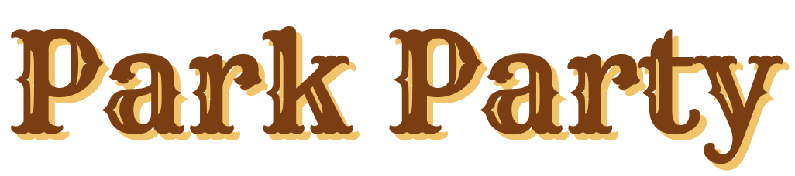
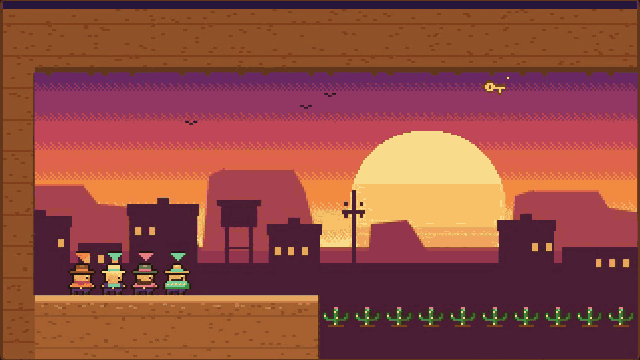
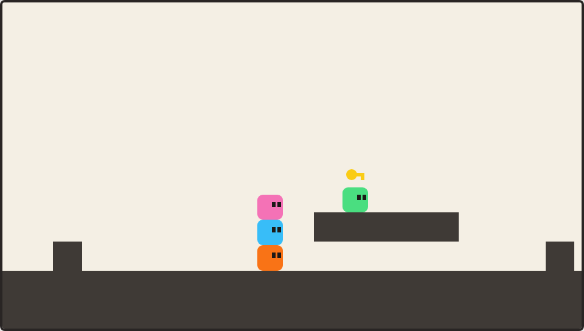
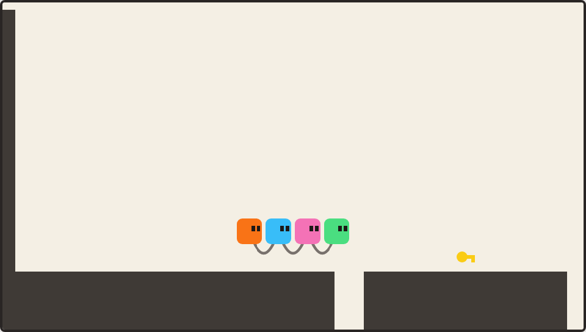
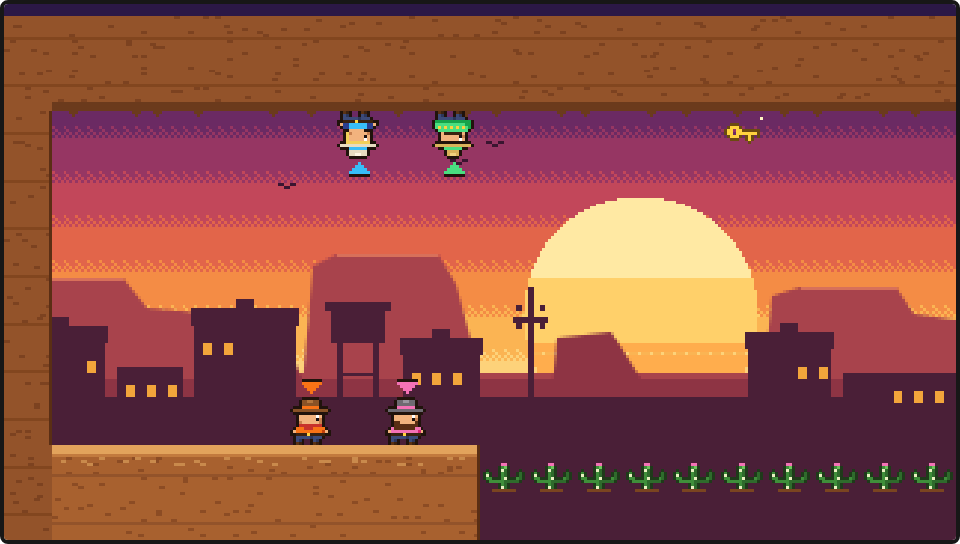
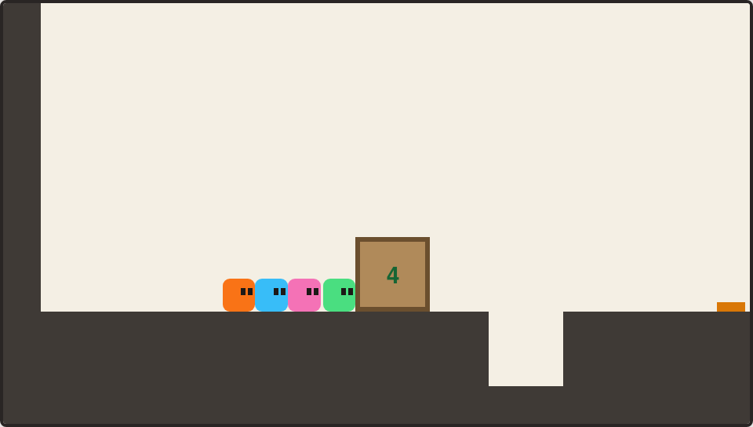
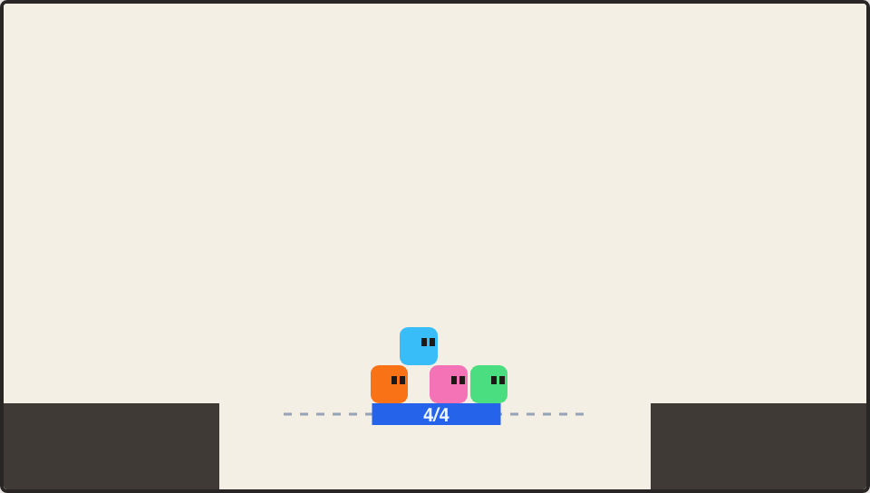
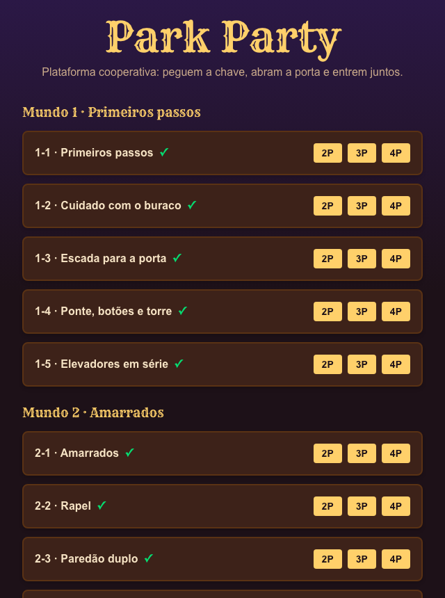

<div align="center">

<h1><picture><source media="(prefers-color-scheme: dark)" srcset="docs/readme/title-park-party-dark.png"></picture></h1>

**A Wild West co-op platformer for 2 to 4 players on one keyboard.**
Grab the key, open the saloon and walk in together — nobody makes it alone.



<sub>Level 8-1 · "Ceiling": all four flip gravity, cross the ceiling above the cacti and come back down with the key.</sub>

</div>

---

Park Party is a browser game inspired by **PICO PARK**: every level is a puzzle that can only
be solved as a team. One player climbs on another's shoulders, everyone pushes the same crate,
the rope tying the group together drags whoever falls behind. If one dies, everyone restarts.

The art is 16-bit Wild West pixel art, in the spirit of 90s arcade run-and-guns: a sunset,
a town on the horizon, cacti, crates and saloon doors. The four cowboys are original
characters, and each one wears their player's color on their clothes and on the little arrow
above their head.

- **61 levels** across **15 worlds**, each world introducing a new mechanic
- **2 to 4 players** on a shared keyboard or gamepads
- Everything that needs "everyone" (heavy crates, platforms, portals) **scales with the group size**
- Progress, level unlocks and **best times per player count** saved in Postgres
- The in-game text is in Brazilian Portuguese

<h2><picture><source media="(prefers-color-scheme: dark)" srcset="docs/readme/title-mechanics-dark.png"></picture></h2>

<table>
  <tr>
    <td width="50%"></td>
    <td width="50%"></td>
  </tr>
  <tr>
    <td><b>Human tower</b> — stack up to reach what nobody can reach alone.</td>
    <td><b>Tied together</b> — a rope links the group; jump out of sync and everyone falls.</td>
  </tr>
  <tr>
    <td></td>
    <td></td>
  </tr>
  <tr>
    <td><b>Upside down</b> — flip gravity and walk on the ceiling.</td>
    <td><b>Brute force</b> — the crate marked 4 only moves if all four push it.</td>
  </tr>
  <tr>
    <td></td>
    <td></td>
  </tr>
  <tr>
    <td><b>Gears</b> — the mine cart only leaves with everyone on board (4/4).</td>
    <td><b>Level select</b> — pick how many are playing; the next level unlocks when you clear the previous one.</td>
  </tr>
</table>

<h3><picture><source media="(prefers-color-scheme: dark)" srcset="docs/readme/title-worlds-dark.png"></picture></h3>

| | World | Mechanic |
|---|---|---|
| 1 | First steps | Stacking, key, crate, button and gate, elevator |
| 2 | Tied together | A rope linking the players |
| 3 | Against the clock | Timed buttons and blinking blocks |
| 4 | Treacherous ground | Falling floors and spikes |
| 5 | Gears | Rail platforms and pushing walls |
| 6 | Gale | Wind |
| 7 | Springs | Trampolines |
| 8 | Upside down | Flipped gravity |
| 9 | Portals | Teleporting |
| 10 | Colors | Colored crates |
| 11 | Blackout | The lights go out periodically |
| 12 | Size | Shrinking and growing |
| 13–15 | Mix · Challenge · Grand finale | Everything at once, ending with level 15-4 "Park Party" |

Levels 3 and 4 of each world are the hard ones: they chain several sections together and mix
the world's mechanic with the earlier ones.

<h2><picture><source media="(prefers-color-scheme: dark)" srcset="docs/readme/title-controls-dark.png"></picture></h2>

| Player | Move | Jump | Action (gravity, etc.) |
|---|---|---|---|
| 🟧 P1 | `A` `D` | `W` | `S` |
| 🟦 P2 | `←` `→` | `↑` | `↓` |
| 🩷 P3 | `J` `L` | `I` | `K` |
| 🟩 P4 | `Num 4` `Num 6` | `Num 8` | `Num 5` |

Gamepads work too: gamepad N controls player N. `R` restarts the level, `Esc` goes back to the
menu and `Enter` moves on to the next level once you clear one.

<h2><picture><source media="(prefers-color-scheme: dark)" srcset="docs/readme/title-running-locally-dark.png"></picture></h2>

Requirements: Node 20.9+ and Docker (for Postgres).

```bash
npm install
cp .env.example .env     # local Postgres DATABASE_URL (port 5434)
npm run db:up            # starts Postgres with docker compose
npm run db:migrate       # creates the tables
npm run db:seed          # writes the 61 levels to the database
npm run dev              # http://localhost:3000
```

<h2><picture><source media="(prefers-color-scheme: dark)" srcset="docs/readme/title-how-its-made-dark.png"></picture></h2>

- **Next.js 16** (App Router, Server Components) + **React 19** + **Tailwind 4**
- **Canvas 2D** at an internal resolution of 320×180, scaled up as pixel art; sprites are text
  grids (`src/game/render/sprites.ts`), and the map and background are drawn once per level
- **Custom fixed-step engine** in TypeScript (`src/game/engine/`): tile and AABB collision,
  players carrying each other, rope, flipped gravity, portals, scaling…
- **Postgres + Drizzle** for levels, progress and best times
- **Vitest + Playwright**: every level has a test where a bot solves it with 2 players, so no
  impossible level ever ships

```bash
npm test             # unit tests + every level solved by a bot
npm run test:e2e     # browser: menu, keyboard and restart
npm run typecheck && npm run lint
```

The mechanics were reimplemented from studying how the original game behaves (notes in
[`docs/re/`](docs/re/), in Portuguese). **Every level is original**: no level, art or asset from
PICO PARK was copied.

---

<sub>Fan project, non-commercial. Not affiliated with TECOPARK, PICO PARK or Konami.</sub>
