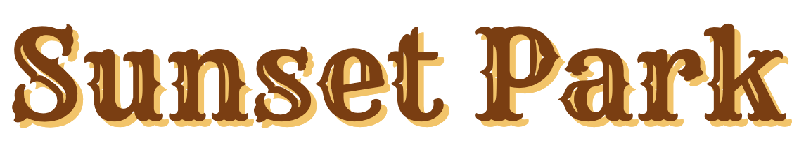
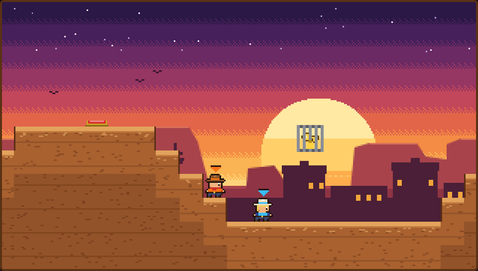
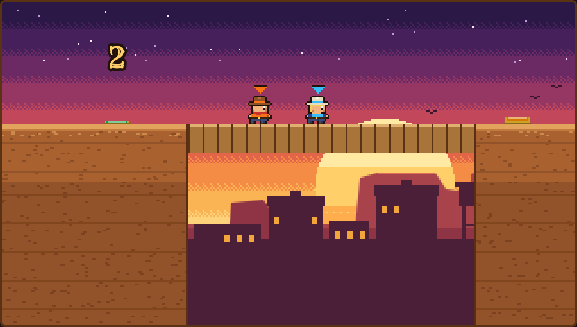
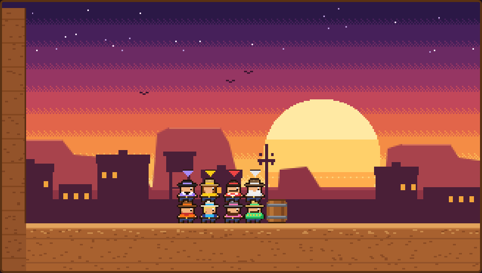
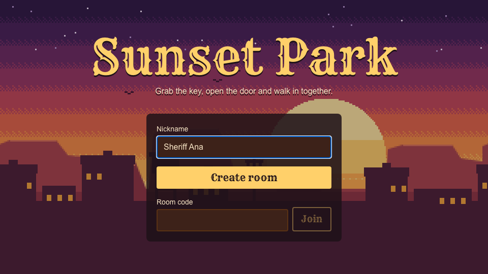
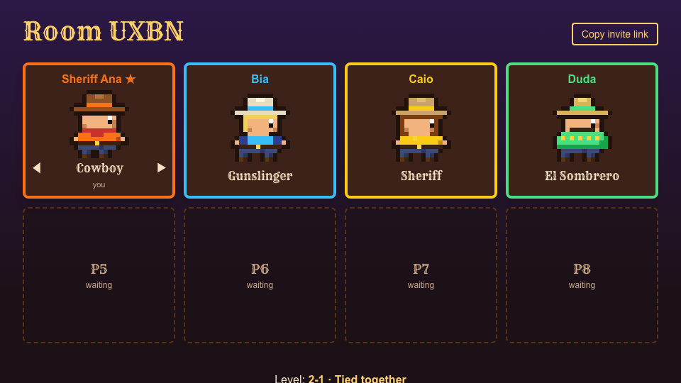

<div align="center">

<h1><picture><source media="(prefers-color-scheme: dark)" srcset="docs/readme/title-sunset-park-dark.png"></picture></h1>

**A Wild West co-op platformer for 2 to 8 players, online with your friends.**
Grab the key, open the saloon and walk in together — nobody makes it alone.


<sub>Level 8-1 · "Ceiling": all four flip gravity, cross the ceiling above the cacti and come back down with the key.</sub>

</div>

---

Sunset Park is a browser game inspired by **PICO PARK**: every level is a puzzle that can only
be solved as a team. One player climbs on another's shoulders, everyone pushes the same crate,
the rope tying the group together drags whoever falls behind. If one dies, everyone restarts.

The art is 16-bit Wild West pixel art, in the spirit of 90s arcade run-and-guns: a sunset,
a town on the horizon, cacti, crates and saloon doors. The eight cowboys are original
characters, each with their own color on their clothes and on the little arrow above their head.
Every player picks one in the room before the game starts.

- **65 levels** across **16 worlds**, each world introducing a new mechanic
- **2 to 8 players online**: create a room, share the link, everyone plays from their own browser
- **Rooms**: pick a nickname and a cowboy; the host picks the level (or hits **Random**) and starts
- **Chiptune sound effects** synthesized live in the browser (no audio files), with a mute toggle
- Everything that needs "everyone" (heavy crates, platforms, portals) **scales with the group size**
- All levels open from the start; **best times per player count** saved in Postgres
- **Rollback netcode**: your cowboy reacts instantly, even with friends in another country
- All in-game text is in English

<h2><picture><source media="(prefers-color-scheme: dark)" srcset="docs/readme/title-mechanics-dark.png"></picture></h2>

<table>
  <tr>
    <td width="50%"></td>
    <td width="50%"></td>
  </tr>
  <tr>
    <td><b>Human tower</b> — stack up to reach what nobody can reach alone.</td>
    <td><b>Tied together</b> — a rope links the group; jump out of sync and everyone falls.</td>
  </tr>
  <tr>
    <td></td>
    <td></td>
  </tr>
  <tr>
    <td><b>Upside down</b> — flip gravity and walk on the ceiling.</td>
    <td><b>Brute force</b> — the crate marked 4 only moves if all four push it.</td>
  </tr>
  <tr>
    <td></td>
    <td></td>
  </tr>
  <tr>
    <td><b>Gears</b> — the mine cart only leaves with everyone on board (4/4).</td>
    <td><b>Caged key</b> — a button somewhere else unlocks the cage; then you still have to reach it.</td>
  </tr>
  <tr>
    <td></td>
    <td></td>
  </tr>
  <tr>
    <td><b>Countdown bridge</b> — the bridge only exists while someone holds the button; let go and the big number counts down.</td>
    <td><b>Up to 8 players</b> — players 5–8 start on the heads of players 1–4.</td>
  </tr>
  <tr>
    <td></td>
    <td></td>
  </tr>
  <tr>
    <td><b>Title screen</b> — pick a nickname, then create a room or join one with its code.</td>
    <td><b>Room</b> — friends join through the invite link and pick a cowboy with ← →; nobody can take a cowboy already picked.</td>
  </tr>
  <tr>
    <td colspan="2"></td>
  </tr>
  <tr>
    <td colspan="2"><b>Level picker</b> — every level is open; the host picks one or hits Random, then starts for everyone.</td>
  </tr>
</table>

<h3><picture><source media="(prefers-color-scheme: dark)" srcset="docs/readme/title-worlds-dark.png"></picture></h3>

| | World | Mechanic |
|---|---|---|
| 1 | First steps | Stacking, key, crate, button and gate, elevator |
| 2 | Tied together | A rope linking the players |
| 3 | Against the clock | Timed buttons and blinking blocks |
| 4 | Treacherous ground | Falling floors and spikes |
| 5 | Gears | Rail platforms and pushing walls |
| 6 | Gale | Wind |
| 7 | Springs | Trampolines |
| 8 | Upside down | Flipped gravity |
| 9 | Portals | Teleporting |
| 10 | Colors | Colored crates |
| 11 | Blackout | The lights go out periodically |
| 12 | Size | Shrinking and growing |
| 13–15 | Mix · Challenge · Grand finale | Everything at once, ending with level 15-4 "Sunset Park" |
| 16 | Gold rush | Long levels in the rhythm of PICO PARK 2: caged key, countdown buttons and bridges that only exist while someone holds the button |

Levels 3 and 4 of each world are the hard ones: they chain several sections together and mix
the world's mechanic with the earlier ones. In world 16 the countdowns are too short to cross
alone, so someone always has to hold the button for the others.

<h2><picture><source media="(prefers-color-scheme: dark)" srcset="docs/readme/title-controls-dark.png"></picture></h2>

| Controls | Move | Jump | Action (gravity, etc.) |
|---|---|---|---|
| Keyboard | `←` `→` or `A` `D` | `↑` or `W` | `↓` or `S` |
| Gamepad | Stick or d-pad | `A` button | Stick or d-pad down |

Each player plays from their own browser. In a level, `R` restarts for everyone, `M` toggles sound
and `Esc` (host only) takes everyone back to the room. If someone drops, the level pauses for up to
30 s while they reconnect.

<h2><picture><source media="(prefers-color-scheme: dark)" srcset="docs/readme/title-running-locally-dark.png"></picture></h2>

Requirements: Node 20.9+ and Docker (for Postgres).

```bash
npm install
cp .env.example .env     # local Postgres DATABASE_URL (port 5434)
npm run db:up            # starts Postgres with docker compose
npm run db:migrate       # creates the tables
npm run db:seed          # writes the 65 levels to the database (run again after pulling new levels)
npm run dev              # http://localhost:3000 (Next + WebSocket rooms in server.ts)
```

<h2><picture><source media="(prefers-color-scheme: dark)" srcset="docs/readme/title-how-its-made-dark.png"></picture></h2>

- **Next.js 16** (App Router, Server Components) + **React 19** + **Tailwind 4**
- **Canvas 2D** at an internal resolution of 320×180, scaled up as pixel art; sprites are text
  grids (`src/game/render/sprites.ts`), and the map and background are drawn once per level
- **Custom fixed-step engine** in TypeScript (`src/game/engine/`): tile and AABB collision,
  players carrying each other, rope, flipped gravity, portals, scaling…
- **Web Audio** for the sound effects: each one is a short sequence of synthesized notes
  (`src/game/audio.ts`), triggered by events the engine emits every frame
- **Postgres + Drizzle** for levels and best times
- **WebSocket rooms** (`ws`) in the same Node process as Next (`server.ts`); rooms live in memory.
  The engine is deterministic, so every browser and the server run the same simulation: your input
  applies at once, the others are predicted and corrected (rollback), and the server has the final word
- **Vitest + Playwright**: every level has a test where a bot solves it with 2 players, so no
  impossible level ever ships

```bash
npm test             # unit tests + every level solved by a bot
npm run test:e2e     # browser: two tabs create and join a room, then play a level together
npm run typecheck && npm run lint
```

The mechanics were reimplemented from studying how the original game behaves (notes in
[`docs/re/`](docs/re/), in Portuguese). **Every level is original**: no level, art or asset from
PICO PARK was copied.

---

<sub>Fan project, non-commercial. Not affiliated with TECOPARK, PICO PARK or Konami.</sub>
